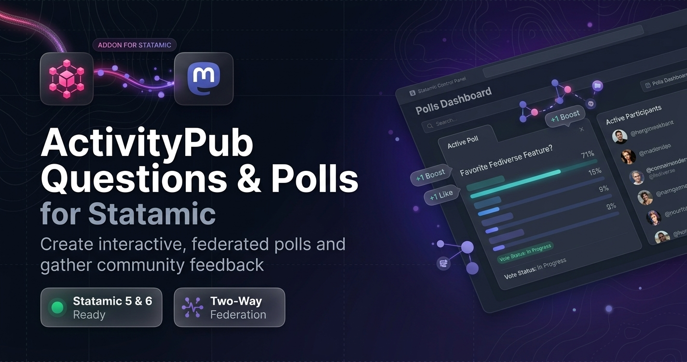
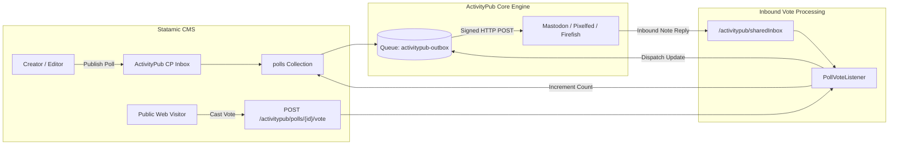
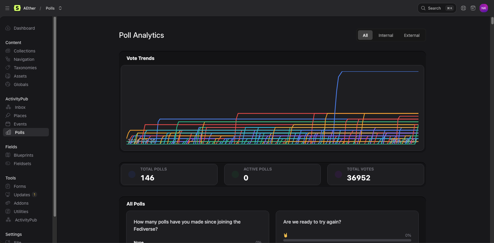
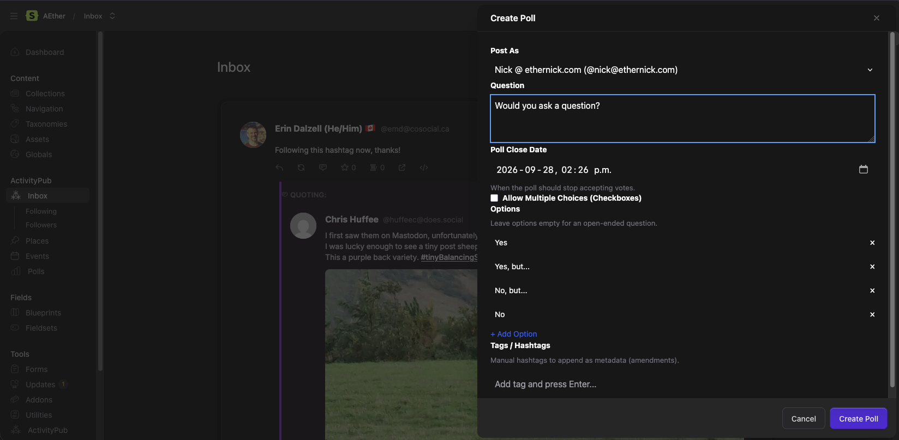
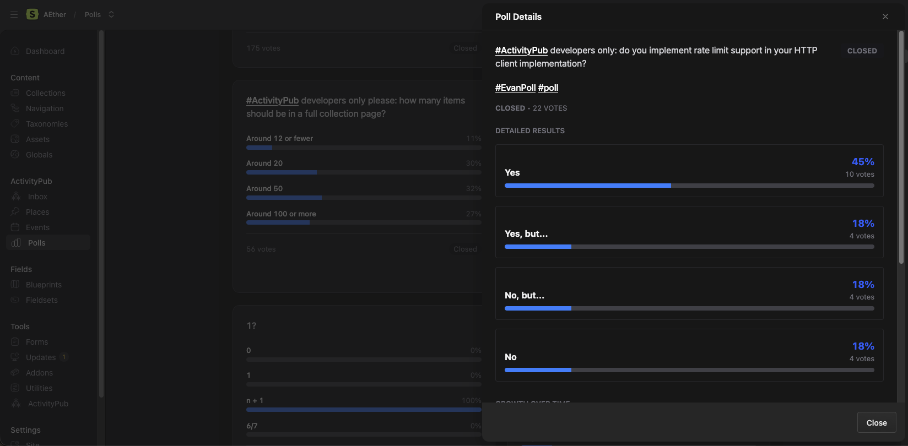
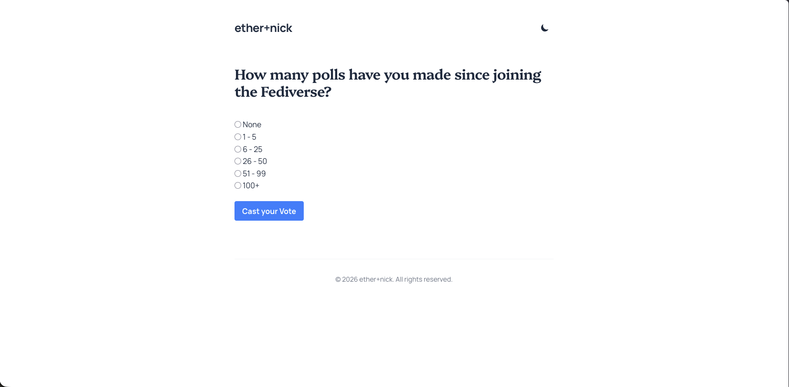

# ActivityPub Questions for Statamic

<p align="center">
  
</p>

[](https://statamic.com)
[](CHANGELOG.md)
[](https://php.net)
[](https://w3.org/TR/activitypub/)
[](LICENSE.md)

> [!NOTE]  
> **Pre-Release:**  
> ActivityPub Questions is an early companion addon for [`statamic-activitypub-core`](https://github.com/ethernick/statamic-activitypub-core). Free for local development and non-production testing under our [Commercial Source-Available License](https://github.com/ethernick/statamic-activitypub-questions/src/branch/main/LICENSE.md). Available for feedback ahead of official Marketplace publication.

Add interactive Fediverse polls, multi-choice surveys, and real-time vote analytics to your Statamic site. **ActivityPub Questions** extends [`statamic-activitypub-core`](https://github.com/ethernick/statamic-activitypub-core) to seamlessly publish ActivityStreams `Question` polls to Mastodon, Pixelfed, and the Fediverse, collect incoming votes, and accept public web votes directly on your site.

---

## ✨ Features at a Glance

| Feature | Description |
|---|---|
| 📊 **Federated Polls (`Question`)** | Broadcast single-choice (`oneOf`) and multiple-choice (`anyOf`) polls across the Fediverse with custom durations and expiration dates. |
| 🗳️ **Automated Vote Ingestion** | Inbound vote replies from Mastodon and remote Fediverse instances are automatically parsed, tallied, and deduplicated. |
| 🔄 **Live Sync & Tally Updates** | When votes arrive, the addon automatically synchronizes tallies and broadcasts ActivityPub `Update(Question)` activities to keep remote servers updated. |
| 📈 **CP Analytics Dashboard** | Real-time analytics view featuring rollup metrics (active polls, total votes), cumulative trend charts, and detailed voter lists. |
| 🌐 **Public Frontend Web Voting** | Built-in Antlers tags (`{{ activitypub_poll:form }}`) let web visitors vote on your site, with automatic AJAX submission and live results swapping. |
| ⏰ **Automated Expiration Worker** | A dedicated console command (`php artisan activitypub:polls-close`) automatically closes expired polls and broadcasts finalized results. |
| ⚡ **Zero-Bloat Sidecar Storage** | Question payloads and vote options are stored cleanly alongside flat-file entries, preserving Stache cache performance. |

---

## 🚀 Quick Start

### 1. Require Package via Composer

Install `activitypub-questions` into your Statamic application root:

```bash
composer require ethernick/statamic-activitypub-questions
```

### 2. Run the Guided Installer

Run the one-step guided installer:

```bash
php artisan activitypub:questions:install
```

The installer automatically:
- Provisions the **`polls`** collection and default `poll.yaml` blueprint with option grids, duration, and expiration settings.
- Configures `/polls/{slug}` nested routing.
- Enables Questions federation in `settings/activitypub.yaml`.
- Publishes Control Panel Vue 2 (Statamic 5) and Vue 3 (Statamic 6) assets.

### 3. Schedule Poll Expiration Worker

To ensure polls close promptly when their duration ends, schedule the close worker in your application's `routes/console.php` (or `app/Console/Kernel.php`):

```php
use Illuminate\Support\Facades\Schedule;

Schedule::command('activitypub:polls-close')->everyMinute();
```

---

## 🏛️ System Architecture



---

## 🏷️ Antlers Frontend Tags

Display interactive polls and real-time voting widgets on your public site using the `{{ activitypub_poll }}` Antlers tags:

### Default Voting Form (`{{ activitypub_poll:form }}`)

Renders a pre-built, accessible HTML voting form that automatically swaps for results if the poll is closed:

```antlers
<div class="poll-wrapper max-w-lg mx-auto my-8 p-6 bg-white rounded-xl shadow-md border">
    <h2 class="text-2xl font-bold mb-4">{{ title }}</h2>
    
    <!-- Renders form or results if closed -->
    {{ activitypub_poll:form }}
</div>

<!-- Bundles AJAX submission script -->
{{ activitypub_poll:script }}
```

### Custom Form & Live Results Markup

For advanced styling, tailor both the submission form and the post-vote results view:

```antlers
<div class="poll-card p-6 bg-gray-50 rounded-xl" data-poll-id="{{ id }}">
    <h3 class="text-xl font-bold mb-3">{{ title }}</h3>

    {{ activitypub_poll:form }}
        <form action="{{ action }}" method="{{ method }}">
            {{ csrf }}
            <fieldset class="space-y-3 mb-4">
                {{ options }}
                    <label class="flex items-center gap-3 p-3 bg-white rounded border cursor-pointer hover:bg-blue-50">
                        <input type="{{ type }}" name="{{ ref }}" value="{{ name }}" class="text-blue-600">
                        <span>{{ name }}</span>
                    </label>
                {{ /options }}
            </fieldset>
            <button type="submit" class="px-5 py-2 bg-blue-600 text-white font-medium rounded-lg hover:bg-blue-700">
                Vote Now
            </button>
        </form>
    {{ /activitypub_poll:form }}

    {{ activitypub_poll:results }}
        <div class="poll-results space-y-3 mt-4">
            <h4 class="font-semibold text-gray-700">Current Results:</h4>
            {{ options }}
                <div>
                    <div class="flex justify-between text-sm mb-1 font-medium">
                        <span>{{ name }}</span>
                        <span>{{ percentage }}% ({{ votes }} votes)</span>
                    </div>
                    <div class="w-full bg-gray-200 rounded-full h-3">
                        <div class="bg-blue-600 h-3 rounded-full" style="width: {{ percentage }}%"></div>
                    </div>
                </div>
            {{ /options }}
            <p class="text-sm text-gray-500 mt-3">Total votes: {{ total_votes }}</p>
        </div>
    {{ /activitypub_poll:results }}
</div>

{{ activitypub_poll:script }}
```

---

## 🖼️ Control Panel Experience

| Poll Analytics Dashboard | Create New Poll Drawer |
| :---: | :---: |
|  |  |

| Poll Results & Voter Breakdown | Public Web Voting View |
| :---: | :---: |
|  |  |

---

## 📚 Documentation & Guides

- **[Production Operator & Installation Guide](docs/INSTALLATION.md)** — Requirements, automated setup, scheduler configuration, and web templates.
- **[Troubleshooting & Operations Runbook](docs/TROUBLESHOOTING.md)** — Resolutions for vote tallying, expiration scheduling, and Mastodon reply compatibility.
- **[Questions Federation & Architecture Guide](docs/QUESTIONS_GUIDE.md)** — ActivityStreams 2.0 `Question` specs, vote ingestion lifecycle, and `Update` activity broadcasts.
- **[Extension Developer Guide (HOOKS.md)](docs/HOOKS.md)** — Extending outbox formatting, listening to vote events, and customizing Antlers templates.
- **[Marketplace Launch Blueprint](docs/MARKETPLACE_LAUNCH.md)** — Hero banner specs, screenshot capture briefs, demo video storyboard, and marketing copy pack.
- **[Product Requirements Document](docs/PRD.md)** — Architectural intent, domain models, and technical history.
- **[Task Roadmap & Release Checklist](docs/TASKS.md)** — Punch-list and milestones.

---

## 🤝 Community & Support

- **Bug Reports & Issues**: [GitHub Issues](https://github.com/ethernick/statamic-activitypub-questions/issues)
- **Source Code**: [GitHub Repository](https://github.com/ethernick/statamic-activitypub-questions)
- **ActivityPub Core**: [Core Addon Repository](https://github.com/ethernick/statamic-activitypub-core)

---

## 📄 License

ActivityPub Questions for Statamic is source-available software provided under the **[Statamic Commercial License](LICENSE.md)** (free for local development and non-production testing; requires a valid commercial license for live production deployments).

## 🦾 AI Disclosure

Written with the assistance of AI agents including Gemini & Claude.
 