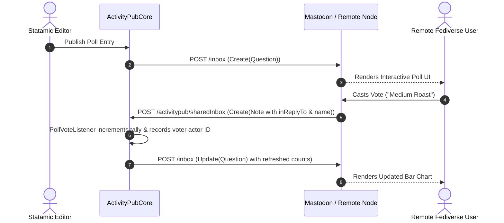

# ActivityPub Questions & Polls Specification Guide

This document explains the technical architecture, data model, ActivityStreams 2.0 vocabulary implementation, and lifecycle of the **ActivityPubQuestions** addon.

---

## 1. Overview & W3C Vocabulary Mapping

ActivityPub implements polling via the **`Question`** object type defined in the W3C ActivityStreams 2.0 specification. Unlike basic status updates (`Note`), a `Question` contains structured choice arrays, expiration timestamps, and special reply semantics.

### AS2 Object Mapping:

```json
{
  "@context": "https://www.w3.org/ns/activitystreams",
  "id": "https://statamic.example.com/activitypub/polls/best-coffee-roasters",
  "type": "Question",
  "attributedTo": "https://statamic.example.com/activitypub/actors/editor",
  "content": "<p>What is your favourite coffee roasting profile?</p>",
  "endTime": "2026-10-01T12:00:00Z",
  "oneOf": [
    {
      "name": "Light Roast (Fruit/Floral)",
      "type": "Note",
      "replies": { "type": "Collection", "totalItems": 14 }
    },
    {
      "name": "Medium Roast (Chocolate/Nutty)",
      "type": "Note",
      "replies": { "type": "Collection", "totalItems": 38 }
    },
    {
      "name": "Dark Roast (Roasty/Smoky)",
      "type": "Note",
      "replies": { "type": "Collection", "totalItems": 9 }
    }
  ],
  "votersCount": 61
}
```

---

## 2. Selection Modalities: `oneOf` vs `anyOf`

The addon supports two distinct poll modalities:

| Mode | Field Value | Description | Remote Client UI |
| :--- | :--- | :--- | :--- |
| **Single Choice** | `oneOf` | Voter may select exactly one option | Radio buttons (`( )`) |
| **Multiple Choice** | `anyOf` | Voter may select one or more options | Checkboxes (`[x]`) |

When formatting outbound payloads via `QuestionPayloadFormatter`, the addon selects either the `oneOf` or `anyOf` property based on the entry's `poll_type` field.

---

## 3. The Vote Federation Lifecycle

Voting across the fediverse involves a multi-step circular verification flow:



### Steps Explained:
1. **Creation**: When a poll entry is published in Statamic, `QuestionPayloadFormatter` formats the AS2 JSON and Core broadcasts `Create(Question)` to all followers.
2. **Remote Voting**: The remote actor clicks their choice in Mastodon or another AP client.
3. **Inbound Response**: Mastodon generates an incoming `Create` activity containing a `Note` whose `inReplyTo` points to the poll and whose `name` contains the plaintext option label.
4. **Listener Tallying**: `PollVoteListener` intercepts the incoming note, verifies that the voter hasn't already voted (by checking `voters`), increments the option vote count and `voters_count`, and persists the entry.
5. **Synchronization**: Statamic dispatches an `Update(Question)` activity back to federated inboxes to keep remote bar charts accurate.

---

## 4. Closing & Expiration Architecture

Polls cannot accept votes indefinitely. The addon enforces closure through:

1. **Scheduled Evaluation**: The `activitypub:polls-close` Artisan command scans the `polls` collection for entries where:
   - `closed` is false/null, and
   - `end_time` <= current UTC timestamp.
2. **State Locking**: For each expired poll, `closed: true` is written to the entry file.
3. **Closing Broadcast**: Core issues a final `Update(Question)` activity to federated servers. Remote clients immediately switch the poll UI from interactive voting controls to static percentage graphs.

---

## 5. Storage Model

Polls are saved as standard Statamic flat-file YAML entries under `content/collections/polls/{slug}.md`:

```yaml
id: 550e8400-e29b-41d4-a716-446655440000
blueprint: poll
title: 'What is your favourite coffee roasting profile?'
poll_type: oneOf
end_time: '2026-10-01 12:00'
closed: false
voters_count: 61
options:
  -
    key: opt_1
    label: 'Light Roast (Fruit/Floral)'
    votes: 14
  -
    key: opt_2
    label: 'Medium Roast (Chocolate/Nutty)'
    votes: 38
  -
    key: opt_3
    label: 'Dark Roast (Roasty/Smoky)'
    votes: 9
voters:
  - 'https://mastodon.social/users/alice'
  - 'https://fosstodon.org/users/bob'
```
